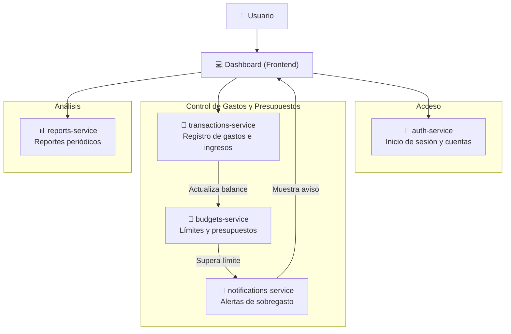

# Centavo 🪙

**Centavo** es una aplicación de finanzas personales diseñada para uso individual. Permite llevar un control riguroso y sencillo de gastos cotidianos, fijar presupuestos mensuales o por categorías, recibir alertas inmediatas de sobregasto y generar reportes financieros automatizados.

---

## 🏗️ Arquitectura General

El proyecto está estructurado como un **monorepo** compuesto por una aplicación cliente (frontend) y un conjunto de microservicios independientes, desacoplados y enfocados en dominios específicos de negocio.



---

## 📦 Componentes del Sistema

| Componente | Carpeta | Propósito |
| :--- | :--- | :--- |
| **Frontend Dashboard** | `frontend/` | Interfaz gráfica e interactiva de usuario. Permite visualizar balances, ingresar transacciones en tiempo real, configurar límites presupuestarios y consultar reportes y alertas. |
| **Auth Service** | `auth-service/` | Gestión de identidad, registro, inicio de sesión y emisión de tokens seguros (JWT) para autorizar las solicitudes a los demás servicios. |
| **Transactions Service** | `transactions-service/` | Núcleo transaccional de la app. Administra el registro, edición, eliminación y categorización de gastos e ingresos. Emite eventos cada vez que se crea o modifica un movimiento. |
| **Budgets Service** | `budgets-service/` | Gestión de presupuestos por periodo (ej. mensual) y categoría. Compara los consumos reales contra los umbrales definidos y detecta condiciones de sobregasto. |
| **Notifications Service** | `notifications-service/` | Motor de alertas reactivas. Recibe avisos de sobregasto o límites alcanzados y despacha notificaciones al usuario (en la app, correo, etc.). |
| **Reports Service** | `reports-service/` | Agregador y generador de resúmenes financieros periódicos (semanales, mensuales, anuales) y métricas de hábitos de gasto. |

---

## 📁 Estructura del Monorepo

```text
centavo/
├── README.md
├── frontend/                 # Interfaz de usuario (Dashboard)
├── auth-service/             # Servicio de autenticación
├── transactions-service/     # Servicio de transacciones y categorías
├── budgets-service/          # Servicio de presupuestos
├── notifications-service/    # Servicio de alertas y notificaciones
└── reports-service/          # Servicio de reportes consolidados
```

---

## 🔄 Flujo de Trabajo Típico

1. **Autenticación**: El usuario se autentica a través del `frontend` contra el `auth-service` y obtiene su token de acceso.
2. **Registro de Gasto**: El usuario registra un nuevo gasto desde el Dashboard; la solicitud es procesada por `transactions-service`.
3. **Control de Presupuesto**: `budgets-service` evalúa si la nueva transacción hace superar el presupuesto asignado para esa categoría o mes.
4. **Alerta**: Si se rebasa el umbral (o se llega al 80%/100%), `budgets-service` notifica a `notifications-service` para advertir al usuario en tiempo real.
5. **Reportes**: Periódicamente o a demanda, `reports-service` procesa el historial para ofrecer un resumen consolidado de ahorros y gastos.
